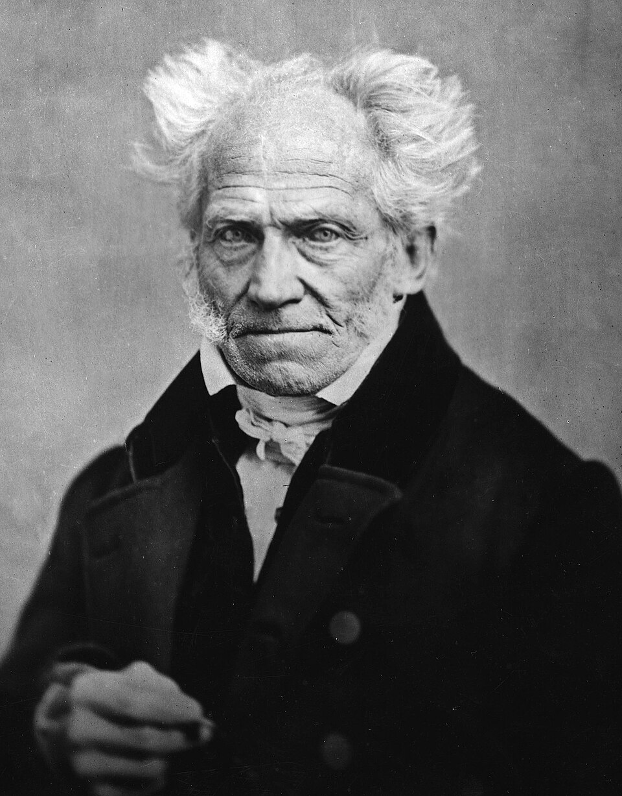
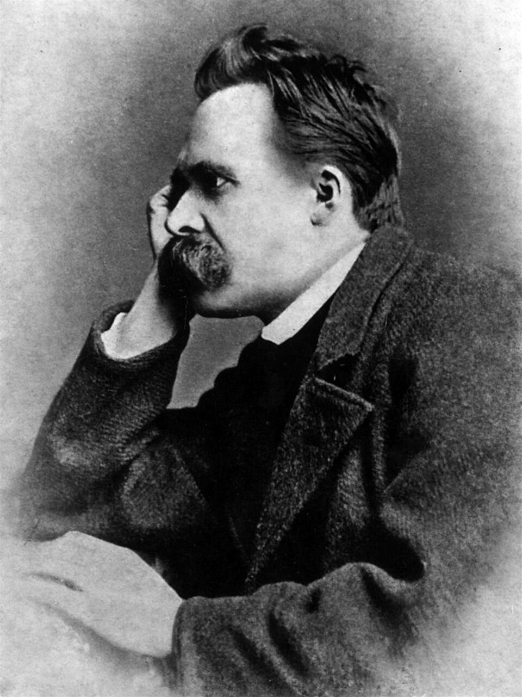
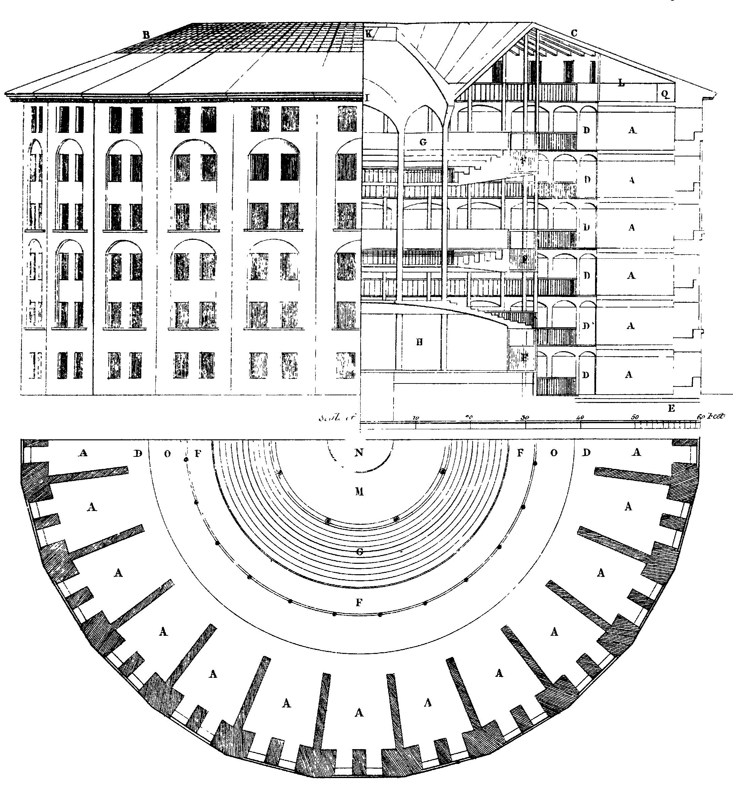
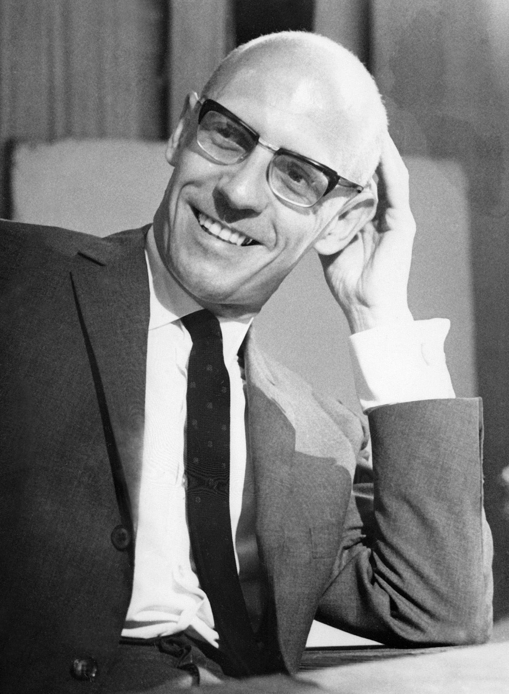

# "No pain, no gain"?

<style>
:root {
  --bg-image: url("imagens/aula10/o_viajante_sobre_o_mar_de_neblina_by_caspar_david_friedrich_1818.jpg");
  --bg-opacity: 0.75;
  --max-width: 95%;
}
</style>

::: {.smaller-list}

- O bordão "no pain, no gain" sugere que o sofrimento é o preço necessário de qualquer ganho. Até que ponto isso é verdade?
- A moral cristã se funda nesse princípio: o sofrimento é sacrifício, caminho para a redenção.
- De Descartes a Kant, a Modernidade apostou na **razão** como caminho de verdade e emancipação.
- Schopenhauer e Nietzsche propõem o oposto: o fundo da realidade é uma força cega, a **Vontade**, de onde nasce o sofrimento; e é a **arte**, não a razão, que alivia essa dor, uma nova filosofia da dor e da estética.

::: {.no-bullets}

- > O homem que jaz doente na cama talvez perceba que em geral está doente de seu ofício, de seus negócios ou de sua sociedade, e que por causa dessas coisas perdeu a capacidade de reflexão sobre si mesmo: ele obtém esta sabedoria a partir do ócio a que sua doença o obriga. (NIETZSCHE, F. *Humano, demasiado humano*, af. 289.)

:::

:::

## Sobre o plano de fundo

::: {.smaller-list}

- O quadro é *O Viajante sobre o Mar de Névoa* (1818), de Caspar David Friedrich, ícone do Romantismo alemão, movimento que nasce como reação ao racionalismo iluminista.
- A figura solitária diante de uma paisagem imensa e enevoada, impossível de medir ou dominar pela razão, encarna o **sublime**: algo que excede a compreensão racional, parente visual da Vontade de Schopenhauer.
- Descartes funda seu método na busca por **ideias claras e distintas**; o elemento central da pintura é justamente o oposto disso: névoa, obscuridade.
- O viajante não conquista nem mede a paisagem, só a contempla, de costas para nós: a contemplação de uma perspectiva individual e situada, não o domínio racional e universal sobre a natureza.
- Não é coincidência: a pintura é do mesmíssimo ano em que Schopenhauer publica *O mundo como vontade e representação* (1818).

:::

# Schopenhauer

## Schopenhauer: o mundo como Vontade e Representação

::: {.smaller-list}

- O mundo se apresenta de duas formas: como **representação** (o mundo fenomênico, tal como o percebemos, organizado por espaço, tempo e causalidade, retomando Kant) e como **Vontade** (a essência única e indivisa da realidade, por trás das aparências).
- É justamente o espaço e o tempo, as formas da representação, que nos permitem distinguir "isto" de "aquilo", "eu" de "você": são eles que fragmentam a Vontade, em si una, na aparência de uma multidão de seres separados.
- Schopenhauer chama essa aparência de multiplicidade de **véu de Maia**, expressão que toma da filosofia indiana: um véu de ilusão que esconde o fato de que, por trás da pluralidade de coisas e indivíduos, há uma só Vontade.
- Essa Vontade não tem objetivo nem descanso: é um impulso infinito e insaciável de desejo, que se manifesta em cada ser individuado, inclusive em nós.
- Daí o pessimismo de Schopenhauer: presos à ilusão da separação, vivemos a vida oscilando entre o sofrimento da falta e o tédio da satisfação.

:::

## Schopenhauer: a arte como libertação da Vontade

::: {.smaller-list}

- Como escapar, ainda que momentaneamente, do sofrimento imposto pela Vontade por trás do véu de Maia?
- Na contemplação estética, o sujeito deixa de ser um indivíduo que deseja e se torna um "puro sujeito do conhecimento": por um instante, o véu se afina, e entrevemos a Vontade una por trás da multiplicidade das coisas.
- A arte revela as Ideias (essências universais), não objetos úteis aos nossos interesses: por isso ela liberta, ainda que por instantes.
- Para Schopenhauer, a música ocupa o lugar mais alto entre as artes: não representa as Ideias, mas expressa diretamente a própria Vontade.

:::

## Arthur Schopenhauer (1788-1860)

::: columns
::: {.column width="70%"}

::: {.smaller-list}

- Viveu na sombra de Hegel, cujo otimismo racionalista rejeitava; suas aulas em Berlim, marcadas de propósito no mesmo horário das dele, tiveram pouquíssimos alunos.
- *O mundo como vontade e representação* (1818), sua obra principal, passou décadas ignorada, só reconhecida no fim da vida.
- Foi um dos primeiros filósofos ocidentais a dialogar com o pensamento oriental (budismo, hinduísmo), o que reforçava sua visão pessimista do desejo.
- Influenciou profundamente Nietzsche, Freud e Wagner.

:::

:::

::: {.column width="30%"}



:::

:::

# Nietzsche

## Nietzsche: apolíneo, dionisíaco e a crítica à tradição filosófica

::: {.smaller-list}

- Em *O nascimento da tragédia* (1872), distingue dois impulsos gregos: o **apolíneo** (ordem, forma, individuação) e o **dionisíaco** (embriaguez, fusão, dissolução do indivíduo).
- A tragédia grega nasce do equilíbrio entre os dois: a arte que encara o caráter trágico da existência sem negá-la.
- A partir daí, critica a tradição filosófica: desde Sócrates e Platão, a razão sufocou o elemento dionisíaco em nome de um "mundo verdadeiro" além da vida sensível.
- Seu método é "filosofar a marteladas": golpear os ídolos da tradição para testar se são ocos ou sólidos.
- ⚠️ Gilles Deleuze, um de seus grandes leitores no séc. XX, retoma essa recusa de hierarquias fixas (como no conceito de rizoma).

:::

## Nietzsche: niilismo e a morte de Deus

::: {.smaller-list}

- A "morte de Deus" não é um fato biológico, mas o diagnóstico de que os valores absolutos que davam sentido ao mundo ocidental perderam sua força.
- Esse vazio de sentido é o **niilismo**: a constatação de que não há mais fundamento último para nossos valores.
- Nietzsche distingue a **moral de senhores** (que afirma a vida e cria valores a partir de si) da **moral de escravos** (que nasce do **ressentimento** dos fracos, e inverte os valores: fraqueza vira virtude).
- A moral cristã é, para ele, uma moral de escravos: ao condenar o desejo e o corpo como culpa, é uma forma de **negação da vida**.
- ⚠️ É aqui que a aula começou: sofrer não é o problema; o problema é fazer do sofrimento uma arma de ressentimento contra a vida.

:::

## Nietzsche: transvaloração dos valores e vontade de potência

::: {.smaller-list}

- Diante do niilismo, Nietzsche propõe criar novos valores: a **transvaloração de todos os valores**.
- A base dessa nova avaliação é a **vontade de potência**: não "vontade de dominar os outros", mas o impulso de toda vida de crescer e se superar.
- Bom e mau deixam de ser categorias fixas e passam a significar o que expande ou diminui essa potência vital.
- A vontade de potência é, para Nietzsche, o princípio explicativo último de toda a realidade, não só da vida humana.

:::

## Nietzsche: eterno retorno, amor fati e o super-homem

::: {.smaller-list}

- O **eterno retorno**: e se você tivesse que reviver sua vida, exatamente como foi, infinitas vezes? Um teste da afirmação da vida.
- Quem responde "sim" pratica o **amor fati**: não resignação, mas afirmação ativa de tudo que se viveu, inclusive o sofrimento.
- O **super-homem** (*Übermensch*) é quem supera os valores herdados, cria os próprios, e é capaz desse "sim" incondicional.
- Juntos, formam a resposta afirmativa ao niilismo: não um novo sistema de verdades fixas, mas uma atitude diante da existência.

:::

## Friedrich Nietzsche (1844-1900)

::: columns
::: {.column width="70%"}

::: {.smaller-list}

- Filólogo clássico, tornou-se professor em Basileia aos 24 anos, o mais jovem catedrático da história da instituição.
- Problemas de saúde crônicos o forçaram a abandonar a vida acadêmica aos 34 anos, dedicando-se então inteiramente à filosofia.
- Em 1889, sofreu um colapso mental definitivo, vivendo os últimos anos sob cuidados da família até morrer em 1900.
- Sua obra foi apropriada pelo nazismo após sua morte, em grande parte por manipulações de sua irmã, apesar de ele ser crítico contundente do nacionalismo e do antissemitismo.

:::

:::

::: {.column width="30%"}



:::

:::

# Foucault

## Foucault: o que é filosofia?

::: {.smaller-list}

- Para Foucault, a filosofia não deve mais perguntar "o que é a verdade?", mas investigar as **condições que permitem que certos enunciados sejam tidos como verdadeiros** em cada época.
- Esse método é a **genealogia**: rastreia as transformações e disputas de poder que produziram ideias e instituições que hoje parecem naturais.
- Foucault chama esse projeto de "história do presente": entender como chegamos a ser o que somos, mostrando que poderia ter sido diferente.
- A filosofia deixa de contemplar verdades eternas e se torna diagnóstico crítico do nosso próprio momento histórico.

:::

## Foucault: saber e poder

::: {.smaller-list}

- Saber e poder não são opostos: são indissociáveis, por isso ele fala em **poder-saber**.
- As relações de poder numa sociedade delimitam o que pode ser pensado e dito em cada época, não só o que pode ser feito.
- Toda verdade produzida gera efeitos de poder: classificar alguém como "louco", "doente" ou "criminoso" já é exercer poder sobre essa pessoa.
- Não existe conhecimento neutro: todo **regime de verdade** está amarrado às relações de poder de seu tempo.

:::

## Foucault: poder disciplinar e microfísica do poder

::: columns
::: {.column width="70%"}

::: {.smaller-list}

- O **poder disciplinar** não é centralizado como o antigo poder do soberano: é minucioso e constante, atuando sobre o corpo para torná-lo dócil e produtivo.
- É exercido pela multiplicação de **dispositivos**: vigilância, exame, divisão do tempo e do espaço, a norma.
- As **instituições totais** (prisões, escolas, hospitais, quartéis) são os laboratórios desse poder, regulando cada detalhe da rotina de quem está sob sua autoridade.
- A isso Foucault chama **microfísica do poder**: o poder não vem só do Estado, mas circula em escala mínima por toda a sociedade.

:::

:::

::: {.column width="30%"}



:::

:::

## Michel Foucault (1926-1984)

::: columns
::: {.column width="70%"}

::: {.smaller-list}

- Estudou na École Normale Supérieure, onde enfrentou depressão profunda, antes de se consolidar como um dos pensadores mais influentes do séc. XX.
- Sua obra percorre loucura (*História da loucura*, 1961), prisão (*Vigiar e punir*, 1975) e sexualidade (*História da sexualidade*, desde 1976).
- Foi ativista: engajou-se pelos direitos dos prisioneiros, de minorias sexuais e, no fim da vida, alertou sobre a epidemia de AIDS.
- Morreu em 1984, uma das primeiras figuras públicas francesas a falecer por complicações da AIDS.

:::

:::

::: {.column width="30%"}



:::

:::

## Síntese: a crítica à modernidade continua

::: {.smaller-list}

- Schopenhauer, Nietzsche e Foucault desmontam pilares do projeto moderno: razão como caminho à verdade, progresso inevitável, sujeito autônomo e transparente a si mesmo.
- Essa crítica segue no séc. XX, com Heidegger (a técnica como esquecimento do ser), Adorno e Horkheimer (a razão que se volta contra si mesma), Marx (alienação), Weber ("jaula de ferro" burocrática) e Bauman ("modernidade líquida").
- Essa crise muda também como entendemos a dor: a promessa de que sofrimento sempre leva a um ganho ordenado perde a garantia que a Modernidade lhe dava.
- Voltamos ao início: "no pain, no gain" talvez nunca tenha sido lei da natureza, mas um valor historicamente construído.
- Questionar essas certezas não é niilismo: é, para esses pensadores, a própria tarefa da filosofia.

:::

# Questões do Enem

## Acompanhe pelo celular

::: {style="text-align: center;"}

{width=40%}

bit.ly/filosofia-vc

:::

```{python}
#| echo: false
#| output: asis

from scripts.render_questoes import render_questao
from IPython.display import HTML

arquivo_yaml = "../dados/questoes_enem.yaml"

questoes = [22, 30, 6, 11, 12, 28]

for i, questao_id in enumerate(questoes, start=1):

  print(f"## Questão {i}")
  html = render_questao(questao_id, arquivo_yaml)
  display(HTML(html))
```
